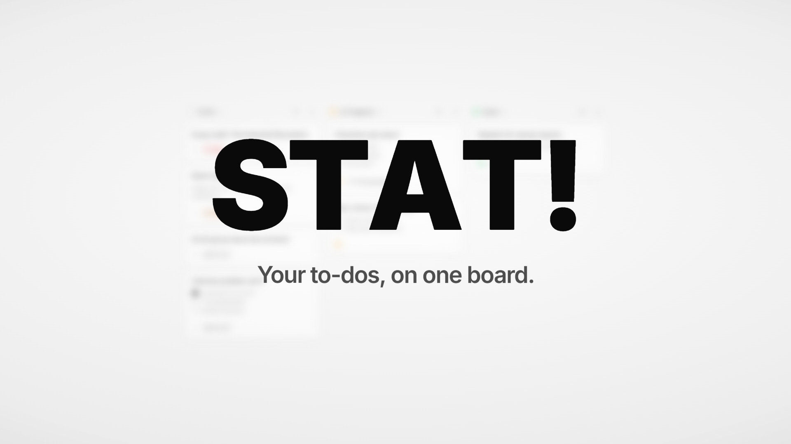

# STAT!

A drag-and-drop to-do board for Windows. Keep School, Work and Personal in their own workspaces, drag cards from **To Do** to **In Progress** to **Done**, and rename or add columns to fit how you work.

- Type `- ` for bullets, or use the toolbar for checklists and numbered lists
- Add due dates, priorities and links to any card
- Color whole cards in pastel shades
- Light, dark or automatic theme
- Every change saves the moment you make it

## Download

Get the latest version from the [**Releases page**](https://github.com/Nej2005/stat-app/releases/latest). There are two versions to choose from:

| File | What it is |
|---|---|
| **[STAT-Setup-0.6.1.exe](https://github.com/Nej2005/stat-app/releases/latest/download/STAT-Setup-0.6.1.exe)** | Installer (recommended). Adds STAT! to the Start menu and desktop, and can be uninstalled from Windows Settings. |
| **[STAT-Portable-0.6.1.exe](https://github.com/Nej2005/stat-app/releases/latest/download/STAT-Portable-0.6.1.exe)** | Single file, no install. Just double-click to run. |

Requires Windows 10 or 11 (64-bit).

### "Windows protected your PC"

STAT! isn't code-signed yet, so the first time you run it Windows SmartScreen may show this warning. Click **More info**, then **Run anyway**. You only need to do this once.

## Your data

Your boards are stored only on your own PC, at `%APPDATA%\STAT!\stat.db`. STAT! runs a small local server on `127.0.0.1` that only your PC can reach. There's no account to make and nothing is uploaded. The installer and the portable version share the same data.

To back up your tasks, close STAT! and copy that folder. Uninstalling the app keeps your data. Delete the folder yourself if you want it gone.
